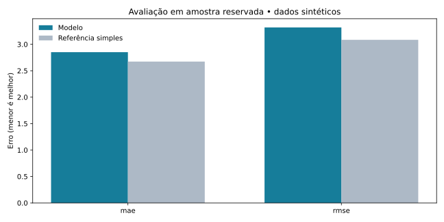

# Regressão linear com variáveis sintéticas

Avaliar regressão linear contra a média do treino sem ajustar a escala sobre o teste.

## Limitações

O alvo foi gerado de forma independente dos atributos. Eventuais diferenças de desempenho neste recorte são variação amostral, não evidência de capacidade preditiva em produção. Não há datas, lojas ou vendas; esta base não permite previsão de vendas.

## Resultados calculados

```json
{
  "task": "regression",
  "split": "random",
  "train_rows": 70,
  "test_rows": 30,
  "features": [
    "feature_1",
    "feature_2"
  ],
  "target": "target",
  "model": "LinearRegression",
  "baseline": "DummyRegressor",
  "model_metrics": {
    "mae": 2.8513245253808064,
    "rmse": 3.31925110642762,
    "r2": -0.15818878761650268
  },
  "baseline_metrics": {
    "mae": 2.6737270555367663,
    "rmse": 3.0845202985925946,
    "r2": -0.00017133627465781842
  },
  "data_rows": 100,
  "data_columns": 3,
  "data_sha256": "edc4367a38c4e92da788de876cbc8fc95f556cb6e50a5cb376e6925596bfafcd",
  "missing_cells": 0,
  "random_seed": 42,
  "data_origin": "synthetic",
  "limitations": "O alvo foi gerado de forma independente dos atributos. Eventuais diferenças de desempenho neste recorte são variação amostral, não evidência de capacidade preditiva em produção. Não há datas, lojas ou vendas; esta base não permite previsão de vendas."
}
```


